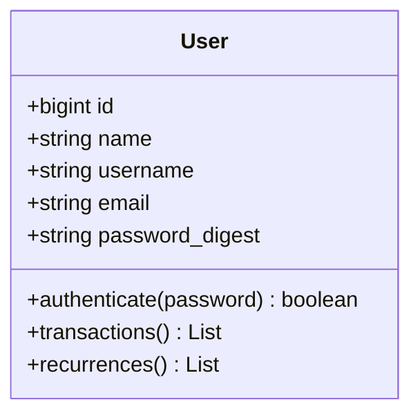

# Potential ADR: Stateful Session-Based Authentication with Rails has_secure_password (bcrypt) and Dual-Identifier Credentials

**Module**: AUTH
**Category**: Security
**Priority**: Must Document (Score: 120)
**Date Identified**: 2026-10-18

---

## Existing ADR Context

ℹ️ **RELATED DECISIONS**

This decision relates to:
- **ADR-003**: Arquitetura Orientada ao Servidor (Hotwire) (`HLD-001.md`, 2026-10-17)

**Timeline Context**:
- Specified concurrently with ADR-003 on `2026-10-17`.
- Because ADR-003 eliminates a decoupled Single Page Application (SPA) in favor of server-rendered Hotwire (Turbo Drive, Turbo Frames, Turbo Streams), stateful HTTP cookie/session authentication integrates natively without needing stateless JWT bearer tokens or OAuth2 token refresh flows.

**When creating formal ADR**: Reference ADR-003 in the Related ADRs section.

---

## What Was Identified

Sqr Finance adopts **self-contained, stateful session-based authentication** built on Ruby on Rails 8's native authentication primitives (`has_secure_password` backed by `bcrypt` and `ActiveSupport::CurrentAttributes` via `Current.user`), rather than delegating identity management to external OAuth2/OIDC providers (such as Auth0, Clerk, or Cognito) or issuing stateless JWT tokens. User credentials are stored directly in the PostgreSQL `users` table via a `password_digest VARCHAR(255) NOT NULL` column alongside two distinct, database-enforced unique identifiers: `username VARCHAR(50) NOT NULL UNIQUE` and `email VARCHAR(255) NOT NULL UNIQUE`.

In accordance with functional requirement RF-001 (`docs/PRD-001.md`), the authentication workflow supports **dual-identifier credential lookup**, allowing users to authenticate using either their `email` or their `username` alongside their password. Once authenticated via `User#authenticate(password)`, the session establishes the request-scoped `Current.user` context inside thin Rails controllers (`docs/HLD-001.md`), which subsequently drives all downstream authorization and Hotwire view rendering.

This decision was defined on 2026-10-17 across `docs/PRD-001.md`, `docs/HLD-001.md`, `docs/tech_spec.md`, and `docs/mermaid/sqr-finance-diagrams.md` as the foundational identity mechanism for the MVP.

## Why This Might Deserve an ADR

- **Impact**: Defines the security perimeter for all synchronous HTTP and Hotwire Turbo requests across `AUTH` and `WEB`, and establishes the schema invariants on the root `users` table in `DATA`.
- **Trade-offs**: Native Rails `bcrypt` authentication (`has_secure_password`) avoids third-party SaaS cost, external network latency, and Devise/OAuth bloat, aligning with the simplicity goal of the Hotwire monolith. However, the engineering team assumes full responsibility for password reset flows, session expiration/rotation, brute-force rate limiting, and CSRF protection.
- **Complexity**: Requires case-insensitive normalization and uniqueness guarantees across two login identifiers (`username` and `email`), constant-time password verification via `bcrypt`, and seamless session persistence across Turbo Drive and Turbo Stream requests.
- **Team Knowledge**: Developers implementing authentication controllers, login queries, and registration forms must understand the dual-identifier lookup contract (`email` or `username`) and how `Current.user` is hydrated per request.
- **Future Implications**: If a native mobile client or external API integration is introduced post-MVP, the stateful cookie session strategy will need to be augmented with token-based authentication (e.g., API tokens or OAuth2).
- **Temporal Context**: Defined in the initial specification baseline (`2026-10-17`) and stable across all architecture artifacts.

## Evidence Found in Codebase

### Key Files
- [`docs/PRD-001.md`](../../../../prds/PRD-001-mvp-controle-financeiro-fluxo-caixa.md) - Lines 21, 44
  - Specifies user registration with unique `email` and `username`, secure login accepting either `email` or `username` (RF-001), and session management.
- [`docs/tech_spec.md`](../../../../tech-specs/TS-001-movimentacoes-recorrencias-agregacao.md) - Lines 13-21
  - Defines the `users` PostgreSQL table with `username VARCHAR(50) NOT NULL UNIQUE`, `email VARCHAR(255) NOT NULL UNIQUE`, and `password_digest VARCHAR(255) NOT NULL` (standard Rails `has_secure_password` / `bcrypt` column convention).
- [`docs/HLD-001.md`](../../../../hlds/HLD-001-arquitetura-monolito-modular-hotwire.md) - Lines 23, 44
  - Depicts the Rails 8 Application Server using Thin Controllers + `Current.user` over HTTPS (HTML / Turbo Stream).
- [`docs/mermaid/sqr-finance-diagrams.md`](../../../../mermaid/sqr-finance-diagrams.md) - Lines 11, 32-40, 72, 87-96
  - Explicitly documents `bcrypt` password encryption (`password_digest`) and `User#authenticate(password)` method on the `User` domain class.

### Code Evidence
```sql
-- From docs/tech_spec.md:13-21
CREATE TABLE users (
    id BIGSERIAL PRIMARY KEY,
    name VARCHAR(150) NOT NULL,
    username VARCHAR(50) NOT NULL UNIQUE,
    email VARCHAR(255) NOT NULL UNIQUE,
    password_digest VARCHAR(255) NOT NULL,
    created_at TIMESTAMP WITH TIME ZONE NOT NULL DEFAULT NOW(),
    updated_at TIMESTAMP WITH TIME ZONE NOT NULL DEFAULT NOW()
);
```



### Impact Analysis
- Introduced: 2026-10-17 (Architecture & Product Specification baseline)
- Affects: 3 modules (`AUTH`, `WEB`, `DATA`)
- Recent themes: "autenticação e sessão", "bcrypt", "password_digest", "Current.user"

### Alternatives (if observable)
- Stateless JWT authentication and decoupled SPA auth flows were implicitly rejected in favor of server-driven Hotwire sessions (`HLD-001.md` ADR-003).

## Questions to Address in ADR (if created)

- Why was Rails 8 built-in authentication (`has_secure_password` + `Current.user`) selected over heavier authentication engines like `Devise` or external Identity Providers (Auth0/OIDC)?
- How should `username` and `email` normalization (e.g., `normalizes :email, with: -> { _1.strip.downcase }`) and case-insensitive uniqueness (`CITEXT` or lower-case indexing) be enforced in PostgreSQL?
- Where are session state and tokens stored (encrypted Rails cookie store vs. database-backed `sessions` table vs. Redis)?
- What rate-limiting controls (e.g., `Rack::Attack` or Rails 8 `rate_limit`) protect the login endpoint against credential stuffing?

## Related Potential ADRs
- [Logical Multi-Tenancy via `Current.user` Association Scoping and HTTP 404 Indistinguishability](./logical-multi-tenancy-with-current-user-scoping-and-404-indistinguishability.md)

## Additional Notes
- Consolidated granular decision: **Dual-Identifier Login (`username` or `email`)** (RF-001) is included within this ADR rather than split into a separate ADR (per Red Flag 5: Overly Granular).
