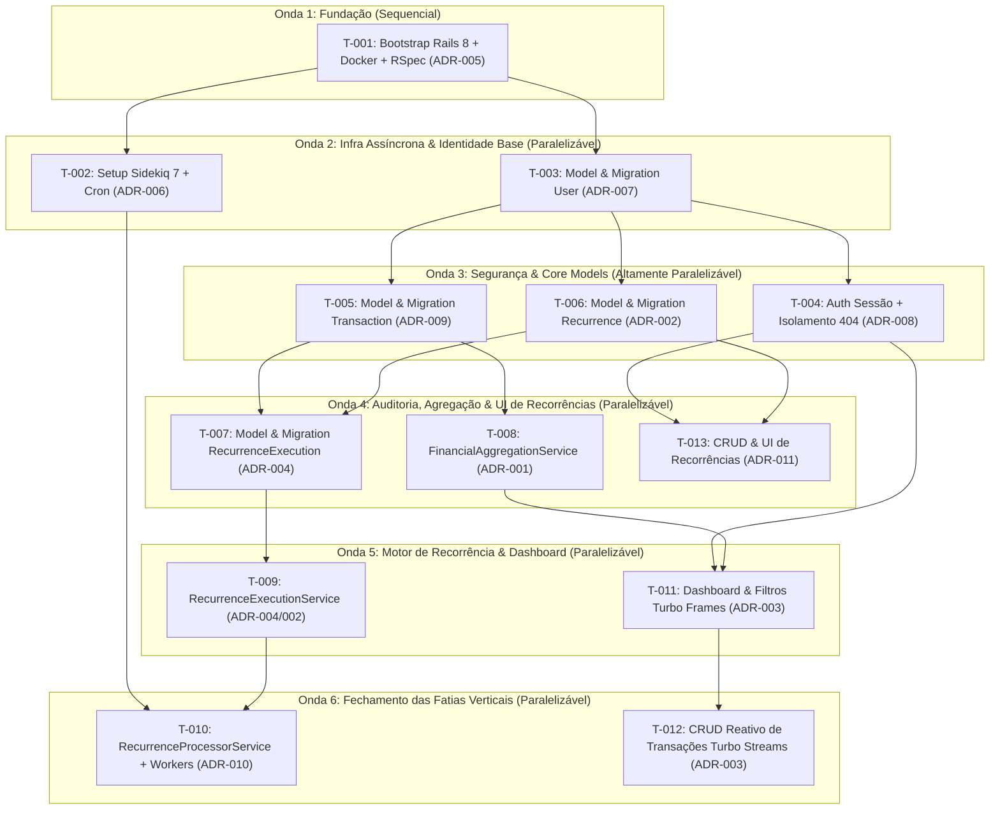

# TASKS-001: Backlog de Implementação do MVP - Sqr Finance

- **ID:** TASKS-001
- **Data:** 2026-10-21
- **Metodologia:** Scrum (INVEST) & Kanban (Fluxo em Ondas Paralelizáveis com Docs-as-Code)
- **Documentos de Referência:**
  - [PRD-001: MVP de Controle Financeiro e Fluxo de Caixa Pessoal](../prds/PRD-001-mvp-controle-financeiro-fluxo-caixa.md)
  - [HLD-001: Arquitetura Monólito Modular e Hotwire](../hlds/HLD-001-arquitetura-monolito-modular-hotwire.md)
  - [TS-001: Mecanismo de Movimentações, Recorrências e Agregação](../tech-specs/TS-001-movimentacoes-recorrencias-agregacao.md)
  - [Índice de ADRs Potenciais](../adrs/potential-adrs-index.md)

---

## 1. Definição das Tasks (Com Entregável de ADR Embutido no DoD)

```json
[
  {
    "id": "T-001",
    "title": "Bootstrap Rails 8, Docker Compose (PostgreSQL 16 + Redis 7) e Suíte RSpec",
    "description": "Inicializar a aplicação Ruby on Rails 8 com PostgreSQL, Tailwind CSS e Hotwire (Turbo + Stimulus). Configurar o docker-compose.yml com PostgreSQL 16 e Redis 7, além de instalar e configurar RSpec, FactoryBot, Shoulda Matchers e RuboCop. Promover a ADR-005 (PostgreSQL 16 ACID Datastore) em `docs/adrs/`. Critério de teste: containers ativos, banco de teste conectado, `bundle exec rspec` + `bundle exec rubocop` passando com 0 falhas e `ADR-005` formalizada.",
    "branch": "chore/T-001-bootstrap-rails-docker-rspec",
    "dependency": "Nenhuma"
  },
  {
    "id": "T-002",
    "title": "Configuração do Sidekiq 7, Sidekiq Cron e Redis Queue",
    "description": "Adicionar e configurar as gems `sidekiq` e `sidekiq-cron`, inicializadores de conexão com o Redis 7, arquivo `config/schedule.yml` base e `Procfile.dev`. Promover a ADR-006 (Asynchronous Job Processing with Redis 7 and Sidekiq 7) em `docs/adrs/`. Critério de teste: spec de configuração validando o carregamento do Sidekiq/Redis, enfileiramento em modo `Sidekiq::Testing.fake!` e `ADR-006` formalizada.",
    "branch": "chore/T-002-setup-sidekiq-cron-redis",
    "dependency": "T-001"
  },
  {
    "id": "T-003",
    "title": "Migration e Model de Usuário (User) com Credenciais Únicas e Bcrypt",
    "description": "Criar a tabela `users` (name, username UNIQUE, email UNIQUE, password_digest) e o model `User` com `has_secure_password`, normalização de e-mail/username e método `.authenticate_by_login` (RF-001). Promover a ADR-007 (Stateful Session Authentication with bcrypt & Dual-Identifier Credentials) em `docs/adrs/`. Critério de teste: model specs testando autenticação, validações, constraints `UNIQUE` no PostgreSQL e `ADR-007` formalizada.",
    "branch": "feat/T-003-user-model-and-migration",
    "dependency": "T-001"
  },
  {
    "id": "T-004",
    "title": "Autenticação de Sessão Dual (Email/Username), Current.user e Isolamento 404",
    "description": "Implementar `Current` (`ActiveSupport::CurrentAttributes`), controllers de cadastro (`RegistrationsController`) e sessão (`SessionsController`) aceitando login por `email` ou `username` (RF-001), além do filtro de autenticação e tratamento padrão `HTTP 404 Not Found` para `ActiveRecord::RecordNotFound` (RF-002). Promover a ADR-008 (Logical Multi-Tenancy via Current.user and HTTP 404 Indistinguishability) em `docs/adrs/`. Critério de teste: request specs validando login dual, logout, bloqueio de rotas não autenticadas, resposta 404 e `ADR-008` formalizada.",
    "branch": "feat/T-004-session-auth-and-tenant-isolation",
    "dependency": "T-003"
  },
  {
    "id": "T-005",
    "title": "Migration e Model de Movimentações (Transaction) com Constraints CHECK e Índice Temporal",
    "description": "Criar a tabela `transactions` com `NUMERIC(12,2)`, índice composto `idx_transactions_user_date (user_id, occurred_at DESC)` e constraints `chk_positive_amount`, `chk_transaction_type` e `chk_payment_method`, além do model `Transaction` com validações espelhadas (RF-003). Promover a ADR-009 (Materialized Financial Transaction Facts & Unsigned Fixed-Point Monetary Model) em `docs/adrs/`. Critério de teste: model specs e testes de banco garantindo que valores <= 0 ou formas de pagamento inválidas são rejeitados no ActiveRecord e no PostgreSQL, e `ADR-009` formalizada.",
    "branch": "feat/T-005-transaction-model-and-schema",
    "dependency": "T-003"
  },
  {
    "id": "T-006",
    "title": "Migration e Model de Recorrências (Recurrence) com Soft-Delete e Constraints Simétricas",
    "description": "Criar a tabela `recurrences` com `deleted_at`, índice parcial `idx_recurrences_user_active WHERE deleted_at IS NULL` e constraints `chk_rec_amount`, `chk_rec_transaction_type`, `chk_rec_frequency`, `chk_rec_payment_method` e `chk_rec_dates`. Implementar o model `Recurrence` com escopos de ciclo de vida e método `soft_delete!` (RF-004, RF-006). Promover a ADR-002 (Decoupling Generated Transactions from Recurrence Rules & History Preservation) em `docs/adrs/`. Critério de teste: model specs validando regras de datas, frequências, soft-delete, constraints SQL e `ADR-002` formalizada.",
    "branch": "feat/T-006-recurrence-model-and-soft-delete",
    "dependency": "T-003"
  },
  {
    "id": "T-007",
    "title": "Migration e Model de Execuções de Recorrência (RecurrenceExecution) com Chave de Idempotência",
    "description": "Criar a tabela `recurrence_executions` com `recurrence_id` (`ON DELETE RESTRICT`), `transaction_id` anulável (`ON DELETE SET NULL`), `scheduled_for` e constraint única `uq_recurrence_cycle UNIQUE (recurrence_id, scheduled_for)`, além do model `RecurrenceExecution` (RF-005, RF-006). Promover a ADR-004 (Database-Enforced Idempotency via RecurrenceExecution Audit Table) em `docs/adrs/`. Critério de teste: specs unitários comprovando `ActiveRecord::RecordNotUnique` em duplicatas, preservação com `transaction_id = NULL` ao excluir `Transaction`, bloqueio `RESTRICT` em `Recurrence` e `ADR-004` formalizada.",
    "branch": "feat/T-007-recurrence-execution-audit-model",
    "dependency": "T-005, T-006"
  },
  {
    "id": "T-008",
    "title": "Implementação do FinancialAggregationService (Consolidação SQL Pushdown)",
    "description": "Implementar `FinancialAggregationService` retornando o DTO imutável `Result` (`Data.define`) com `total_income`, `total_expense`, `period_result`, `accumulated_balance` (histórico até `end_date`) e `transactions` ordenadas (RF-008). Promover a ADR-001 (Dynamic Balance Derivation & In-Database SQL Pushdown Aggregation) em `docs/adrs/`. Critério de teste: service specs testando precisão `BigDecimal`, isolamento entre usuários, períodos vazios, saldo acumulado histórico e `ADR-001` formalizada.",
    "branch": "feat/T-008-financial-aggregation-service",
    "dependency": "T-005"
  },
  {
    "id": "T-009",
    "title": "Implementação do RecurrenceExecutionService (Materialização Atômica e Idempotente)",
    "description": "Implementar `RecurrenceExecutionService.call(recurrence:, target_date:)` que cria em transação ACID uma `Transaction` independente e um registro em `RecurrenceExecution`, ignorando regras excluídas/inativas e tratando `ActiveRecord::RecordNotUnique` de forma silenciosa (RF-005, RF-006). Atualizar a ADR-004 e ADR-002 com evidências do service implementado. Critério de teste: service specs validando criação atômica, taxa zero de duplicidade em chamadas repetidas e imutabilidade histórica.",
    "branch": "feat/T-009-recurrence-execution-service",
    "dependency": "T-007"
  },
  {
    "id": "T-010",
    "title": "Implementação do RecurrenceProcessorService e Sidekiq Workers de Recorrência",
    "description": "Implementar `RecurrenceProcessorService` (cálculo de ciclos semanais/mensais/anuais pendentes até a data de referência e desativação automática quando `end_date < reference_date`), `RecurrenceSchedulerWorker` (00:05 UTC no `schedule.yml`) e `RecurrenceWorker`. Promover a ADR-010 (Fan-Out Cron Scheduling Pattern for Recurring Transactions) em `docs/adrs/`. Critério de teste: specs de serviço e de workers validando o fan-out apenas de ciclos não executados, catch-up retroativo, transição ao atingir `end_date` e `ADR-010` formalizada.",
    "branch": "feat/T-010-recurrence-processor-and-workers",
    "dependency": "T-002, T-009"
  },
  {
    "id": "T-011",
    "title": "Dashboard e Filtros Temporais com Turbo Frames (RF-007, RF-008)",
    "description": "Implementar `DashboardController#index` e `PeriodFilterable` com filtros por `day`, `month`, `year` e intervalo `custom` (máx. 365 dias) integrado ao `FinancialAggregationService`, renderizando os Turbo Frames `dashboard_metrics` e `transactions_list`. Promover a ADR-003 (Server-Driven Reactive UI with Rails 8 and Hotwire) em `docs/adrs/`. Critério de teste: request specs validando a exibição dos 4 indicadores, filtragem cronológica, limite de 365 dias e `ADR-003` formalizada.",
    "branch": "feat/T-011-dashboard-temporal-filters-hotwire",
    "dependency": "T-004, T-008"
  },
  {
    "id": "T-012",
    "title": "CRUD Reativo de Movimentações com Turbo Streams e Stimulus (RF-002, RF-003)",
    "description": "Implementar `TransactionsController` (create, edit, update, destroy) escopado em `Current.user.transactions`, templates Turbo Stream (`prepend` na tabela, `replace` em `dashboard_metrics`, `update` em `transaction_form_container`) e controller Stimulus para alternar `payment_method`. Atualizar a ADR-003 com os contratos de Turbo Stream e Stimulus implementados. Critério de teste: request specs testando atualização instantânea via Turbo Stream e resposta `404 Not Found` para acesso cruzado entre usuários.",
    "branch": "feat/T-012-reactive-transactions-crud-hotwire",
    "dependency": "T-011"
  },
  {
    "id": "T-013",
    "title": "CRUD Reativo e Gestão de Ciclo de Vida de Recorrências (RF-004, RF-006)",
    "description": "Implementar `RecurrencesController` (index, create, update, toggle_active e destroy via `soft_delete!`) escopado em `Current.user.recurrences.not_deleted` com interface Hotwire. Promover a ADR-011 (Thin Controllers with Stateless Domain Service Objects) em `docs/adrs/`. Critério de teste: request specs garantindo que pausar, editar ou excluir (soft-delete) uma recorrência preserva as transações passadas, retorna `404 Not Found` para acessos cruzados e `ADR-011` formalizada.",
    "branch": "feat/T-013-recurrences-crud-and-lifecycle-ui",
    "dependency": "T-004, T-006"
  }
]
```

---

## 2. Ordem de Execução e Raias de Fluxo (Kanban)



---

## 3. Sequência Linear de Execução, Tech Specs e ADRs por Task

| Ordem | ID | Tech Spec | ADR Entregue / Atualizada no DoD | Branch | Título | Dependência | Status |
|---|---|---|---|---|---|---|---|
| 1 | `T-001` | [TS-T001](../tech-specs/tasks/TS-T001-bootstrap-rails-docker-rspec.md) | `ADR-005` (PostgreSQL 16 ACID & Constraints) | `chore/T-001-bootstrap-rails-docker-rspec` | Bootstrap Rails 8, Docker Compose (PostgreSQL 16 + Redis 7) e Suíte RSpec | Nenhuma | [ ] Pendente |
| 2 | `T-002` | [TS-T002](../tech-specs/tasks/TS-T002-setup-sidekiq-cron-redis.md) | `ADR-006` (Redis 7 & Sidekiq 7) | `chore/T-002-setup-sidekiq-cron-redis` | Configuração do Sidekiq 7, Sidekiq Cron e Redis Queue | `T-001` | [ ] Pendente |
| 3 | `T-003` | [TS-T003](../tech-specs/tasks/TS-T003-user-model-and-migration.md) | `ADR-007` (Stateful Auth Bcrypt & Dual Login) | `feat/T-003-user-model-and-migration` | Migration e Model de Usuário (`User`) com Credenciais Únicas e Bcrypt | `T-001` | [ ] Pendente |
| 4 | `T-004` | [TS-T004](../tech-specs/tasks/TS-T004-session-auth-and-tenant-isolation.md) | `ADR-008` (Multi-Tenancy `Current.user` & 404) | `feat/T-004-session-auth-and-tenant-isolation` | Autenticação de Sessão Dual (Email/Username), `Current.user` e Isolamento 404 | `T-003` | [ ] Pendente |
| 5 | `T-005` | [TS-T005](../tech-specs/tasks/TS-T005-transaction-model-and-schema.md) | `ADR-009` (Materialized Facts & Unsigned Monetary) | `feat/T-005-transaction-model-and-schema` | Migration e Model de Movimentações (`Transaction`) com Constraints CHECK e Índice Temporal | `T-003` | [ ] Pendente |
| 6 | `T-006` | [TS-T006](../tech-specs/tasks/TS-T006-recurrence-model-and-soft-delete.md) | `ADR-002` (Decoupled Recurrences & Soft-Delete) | `feat/T-006-recurrence-model-and-soft-delete` | Migration e Model de Recorrências (`Recurrence`) com Soft-Delete e Constraints Simétricas | `T-003` | [ ] Pendente |
| 7 | `T-007` | [TS-T007](../tech-specs/tasks/TS-T007-recurrence-execution-audit-model.md) | `ADR-004` (Relational Idempotency Key) | `feat/T-007-recurrence-execution-audit-model` | Migration e Model de Execuções de Recorrência (`RecurrenceExecution`) com Chave de Idempotência | `T-005, T-006` | [ ] Pendente |
| 8 | `T-008` | [TS-T008](../tech-specs/tasks/TS-T008-financial-aggregation-service.md) | `ADR-001` (Dynamic Balance & SQL Pushdown) | `feat/T-008-financial-aggregation-service` | Implementação do `FinancialAggregationService` (Consolidação SQL Pushdown) | `T-005` | [ ] Pendente |
| 9 | `T-009` | [TS-T009](../tech-specs/tasks/TS-T009-recurrence-execution-service.md) | `ADR-004` / `ADR-002` (Evidência do Service) | `feat/T-009-recurrence-execution-service` | Implementação do `RecurrenceExecutionService` (Materialização Atômica e Idempotente) | `T-007` | [ ] Pendente |
| 10 | `T-010` | [TS-T010](../tech-specs/tasks/TS-T010-recurrence-processor-and-workers.md) | `ADR-010` (Fan-Out Cron Scheduling) | `feat/T-010-recurrence-processor-and-workers` | Implementação do `RecurrenceProcessorService` e Sidekiq Workers de Recorrência | `T-002, T-009` | [ ] Pendente |
| 11 | `T-011` | [TS-T011](../tech-specs/tasks/TS-T011-dashboard-temporal-filters-hotwire.md) | `ADR-003` (Server-Driven UI Hotwire) | `feat/T-011-dashboard-temporal-filters-hotwire` | Dashboard e Filtros Temporais com Turbo Frames (RF-007, RF-008) | `T-004, T-008` | [ ] Pendente |
| 12 | `T-012` | [TS-T012](../tech-specs/tasks/TS-T012-reactive-transactions-crud-hotwire.md) | `ADR-003` (Evidência Turbo Streams & Stimulus) | `feat/T-012-reactive-transactions-crud-hotwire` | CRUD Reativo de Movimentações com Turbo Streams e Stimulus (RF-002, RF-003) | `T-011` | [ ] Pendente |
| 13 | `T-013` | [TS-T013](../tech-specs/tasks/TS-T013-recurrences-crud-and-lifecycle-ui.md) | `ADR-011` (Thin Controllers & Domain Services) | `feat/T-013-recurrences-crud-and-lifecycle-ui` | CRUD Reativo e Gestão de Ciclo de Vida de Recorrências (RF-004, RF-006) | `T-004, T-006` | [ ] Pendente |
