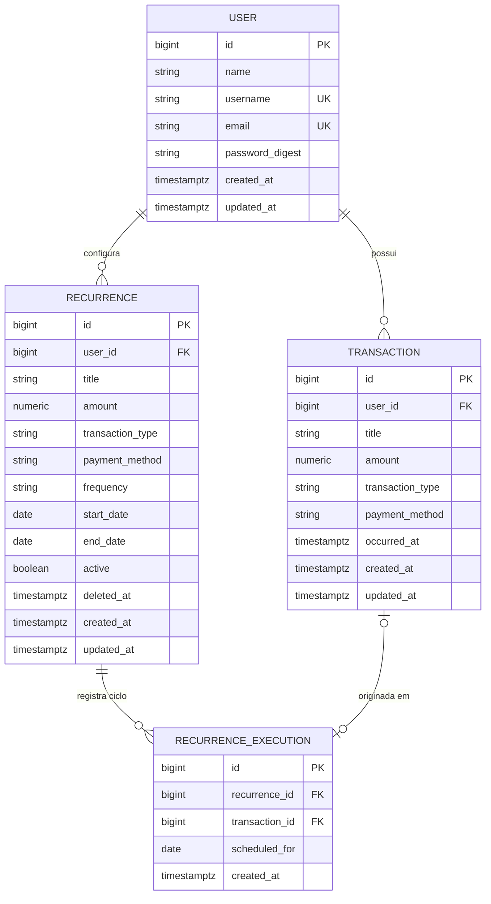
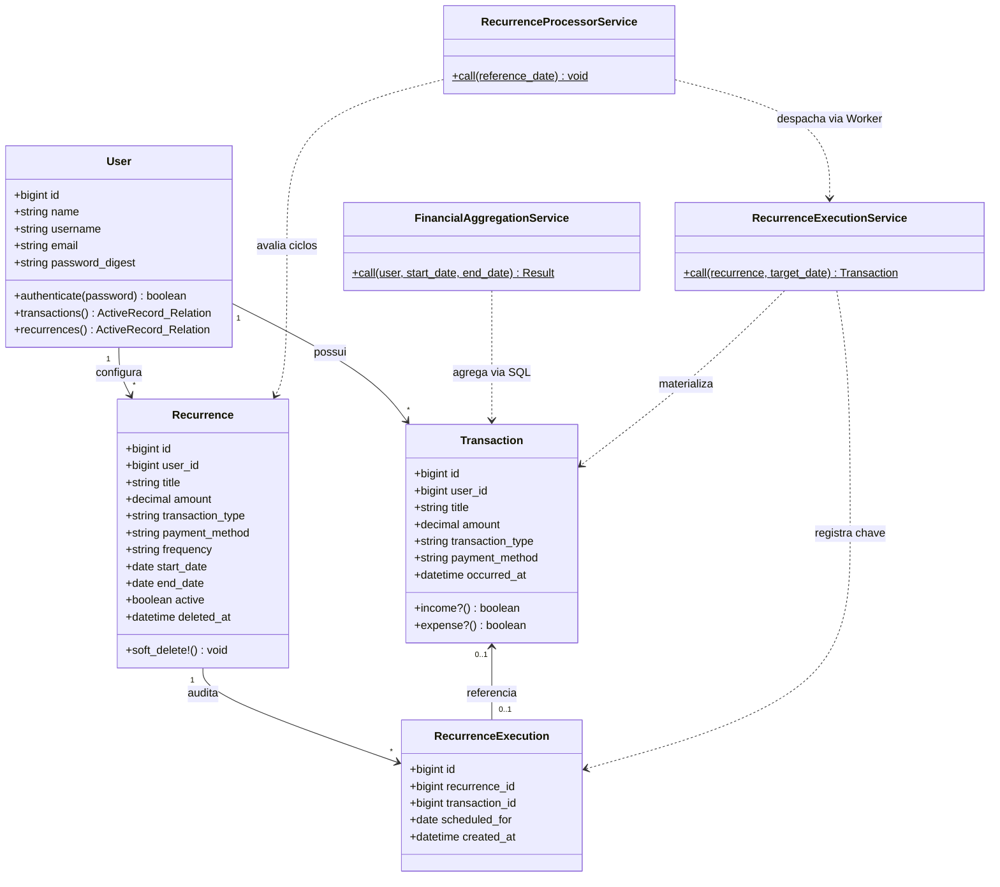
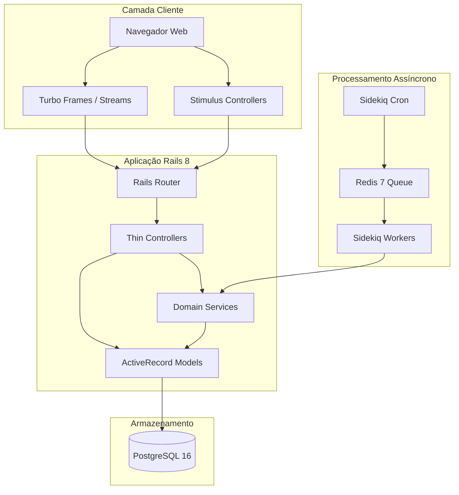
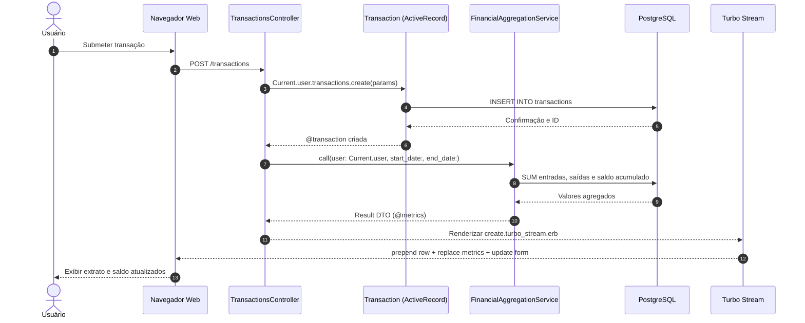
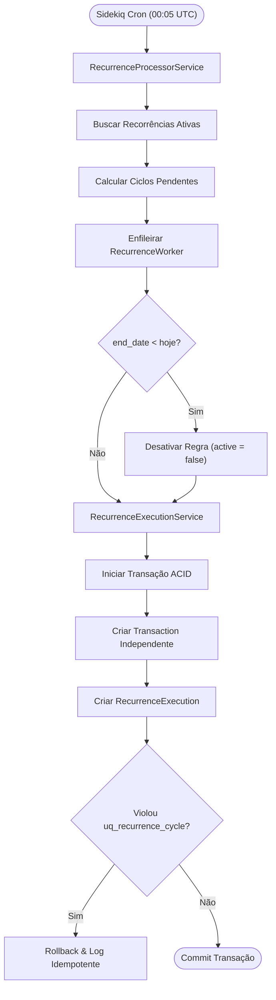
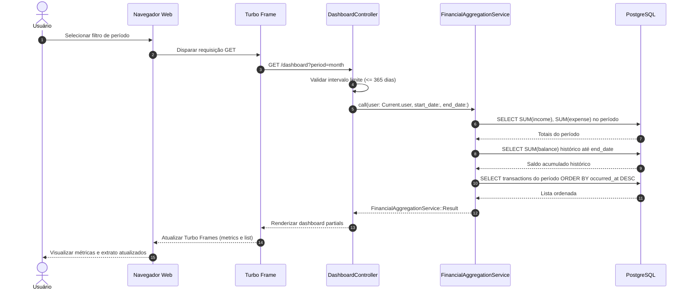
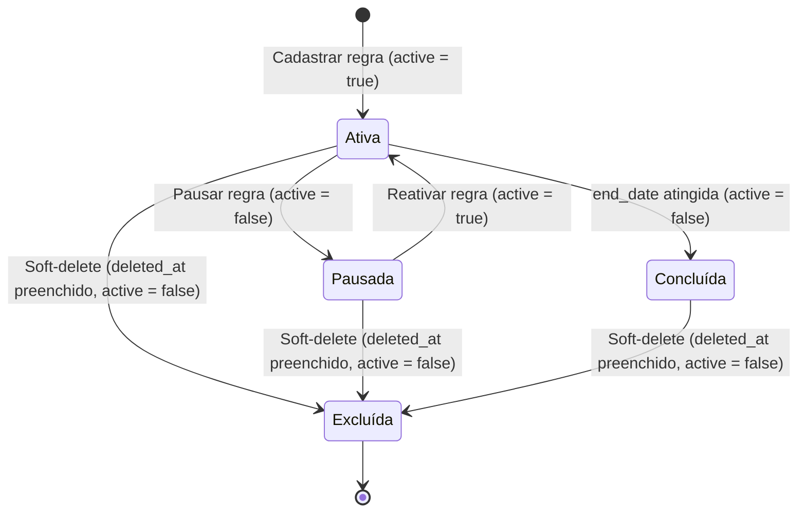

# Diagramas de Arquitetura e Domínio - Sqr Finance

- **Documentos de Referência:**
  - [PRD-001: MVP de Controle Financeiro e Fluxo de Caixa Pessoal](../prds/PRD-001-mvp-controle-financeiro-fluxo-caixa.md)
  - [HLD-001: Arquitetura Monólito Modular e Hotwire](../hlds/HLD-001-arquitetura-monolito-modular-hotwire.md)
  - [TS-001: Mecanismo de Movimentações, Recorrências e Agregação](../tech-specs/TS-001-movimentacoes-recorrencias-agregacao.md)

## Visão Geral

Este documento consolida a modelagem técnica visual e arquitetural do Sqr Finance (MVP de Controle Financeiro e Fluxo de Caixa), fundamentado nas especificações do `PRD-001`, `HLD-001` e `TS-001`. O objetivo central é fornecer clareza estrutural para a engenharia de software sobre o modelo relacional de dados, o isolamento multi-tenant por conta de usuário, a derivação dinâmica e consistente do saldo financeiro e a automação assíncrona idempotente de movimentações periódicas com preservação integral de histórico.

## Elementos Identificados

- **User**: Entidade raiz para autenticação e isolamento lógico de dados (multi-tenancy). Contém identificadores únicos (`username` e `email`) e credenciais criptografadas via `bcrypt`. Não armazena saldo estático, sendo este derivado dinamicamente das transações.
- **Transaction**: Registro de fato contábil efetivo e independente ocorrido no fluxo de caixa. Contém título, tipo (`income` ou `expense`), valor monetário estritamente positivo (`NUMERIC(12,2)`), data de ocorrência (`occurred_at`) e forma de pagamento exclusiva para saídas (`pix`, `debit`, `boleto` ou `cash`). Não possui chave estrangeira direta para `Recurrence`.
- **Recurrence**: Regra de periodicidade configurada pelo usuário (`weekly`, `monthly` ou `yearly`) com início obrigatório e término opcional. Utiliza exclusão lógica (`deleted_at` e `active = false`) para preservar o histórico de auditoria quando removida.
- **RecurrenceExecution**: Entidade técnica de auditoria e linhagem que vincula `Recurrence` e `Transaction`, garantindo idempotência estrita no banco relacional através da constraint única composta `UNIQUE (recurrence_id, scheduled_for)`.
- **Rails MVC e Domain Services Unificados**: Estrutura orientada a Controllers enxutos (`Current.user`), Models ActiveRecord com validações espelhadas no PostgreSQL e três Services stateless dedicados:
  - `FinancialAggregationService`: Consolidação SQL pushdown de entradas, saídas, resultado líquido e saldo acumulado histórico.
  - `RecurrenceProcessorService`: Varredura de regras ativas, cálculo de ciclos devidos e encerramento de regras vencidas (`end_date`).
  - `RecurrenceExecutionService`: Materialização atômica de `Transaction` + `RecurrenceExecution` com tratamento de `ActiveRecord::RecordNotUnique`.
- **Interface Hotwire**: Camada de front-end reativa utilizando Turbo Frames para paginação e filtros sem recarregar a tela, Turbo Streams para mutações parciais no DOM e Stimulus JS para manipulação leve de eventos.
- **Agendador e Filas Assíncronas**: Componentes formados por Sidekiq Cron, Redis 7 e Workers dedicados (`RecurrenceSchedulerWorker` e `RecurrenceWorker`).

---

## Diagramas

### 1. Diagrama de Entidade-Relacionamento (ERD)

**Descrição**:
O Diagrama de Entidade-Relacionamento documenta o modelo relacional de dados do Sqr Finance implementado no PostgreSQL 16 em conformidade com o `HLD-001` e a `TS-001`. A entidade `USER` centraliza o isolamento de dados do sistema, associando-se às regras em `RECURRENCE` e aos lançamentos efetivos em `TRANSACTION`. Para garantir desacoplamento total e imutabilidade histórica (`ADR-002` e `ADR-004`), `TRANSACTION` não possui chave estrangeira para `RECURRENCE`; o rastreamento e a chave de idempotência `(recurrence_id, scheduled_for)` residem na tabela `RECURRENCE_EXECUTION`. A preservação do histórico é assegurada por `deleted_at` em `RECURRENCE`, `ON DELETE RESTRICT` em `recurrence_id` e `ON DELETE SET NULL` em `transaction_id`.

**Notas**:
- Índices únicos em `USER` nos campos `username` e `email` para assegurar identidade exclusiva.
- Índice composto `idx_transactions_user_date` em `TRANSACTION` nas colunas `(user_id, occurred_at DESC)` para otimizar agregações e ordenação cronológica.
- Índice parcial composto `idx_recurrences_user_active` em `RECURRENCE` nas colunas `(user_id, active) WHERE deleted_at IS NULL`.
- Constraint de unicidade composta `uq_recurrence_cycle` em `(recurrence_id, scheduled_for)` na tabela `RECURRENCE_EXECUTION` para garantia de idempotência na execução do Worker.
- Preservação de histórico: `RECURRENCE` utiliza *soft-delete* (`deleted_at`), `RECURRENCE_EXECUTION.recurrence_id` possui `ON DELETE RESTRICT` e `RECURRENCE_EXECUTION.transaction_id` é anulável com `ON DELETE SET NULL`.

---

### 2. Diagrama de Classes do Domínio

**Descrição**:
O Diagrama de Classes do Domínio detalha a modelagem orientada a objetos dos Models ActiveRecord e dos três Domain Services unificados da aplicação Ruby on Rails 8 (`FinancialAggregationService`, `RecurrenceProcessorService` e `RecurrenceExecutionService`).

**Notas**:
- Validação simétrica (`CHECK` + ActiveRecord) em `Transaction` e `Recurrence` exigindo `amount > 0`, `transaction_type` válido e `payment_method` exclusivo para `expense`.
- `FinancialAggregationService` retorna um Value Object imutável `Result` (`Data.define`) com os valores agregados em SQL.
- `RecurrenceExecutionService` isola a transação ACID de criação da `Transaction` e da `RecurrenceExecution`.

---

### 3. Diagrama de Arquitetura de Componentes

**Descrição**:
O Diagrama de Arquitetura de Componentes descreve a topologia em camadas da aplicação monolítica moderna construída com Ruby on Rails 8.

---

### 4. Diagrama de Sequência: Registro de Transação e Atualização Reativa

**Descrição**:
Este diagrama de sequência documenta a interação ponta a ponta durante o cadastro de uma nova movimentação financeira efetiva (`RF-003`). O `TransactionsController` cria o registro diretamente através do escopo `Current.user.transactions`, aciona o `FinancialAggregationService` para recalcular os indicadores do período filtrado e retorna um payload `Turbo Stream` que atualiza o extrato, os cards de métricas e reseta o formulário em uma única viagem HTTP.

---

### 5. Diagrama de Fluxo: Processamento Idempotente de Recorrências

**Descrição**:
O Diagrama de Fluxo detalha a lógica combinada do `RecurrenceSchedulerWorker` (`RecurrenceProcessorService`) e do `RecurrenceWorker` (`RecurrenceExecutionService`) para materialização de movimentações recorrentes (`RF-005` e `RF-006`).

---

### 6. Diagrama de Sequência: Consulta e Agregação de Dashboard

**Descrição**:
Este diagrama de sequência ilustra o processo dinâmico de agregação e exibição das métricas financeiras ao navegar por períodos no dashboard (`RF-007` e `RF-008`) utilizando o `FinancialAggregationService`.

---

### 7. Diagrama de Estados: Ciclo de Vida da Regra de Recorrência

**Descrição**:
O Diagrama de Estados descreve as fases e transições no ciclo de vida de uma regra de recorrência financeira (`RF-004` e `RF-006`). A transição para `Excluída` é implementada via *soft-delete* (`deleted_at = Time.current, active = false`), preservando permanentemente todas as transações passadas em `transactions` e todo o histórico de auditoria em `recurrence_executions`.

