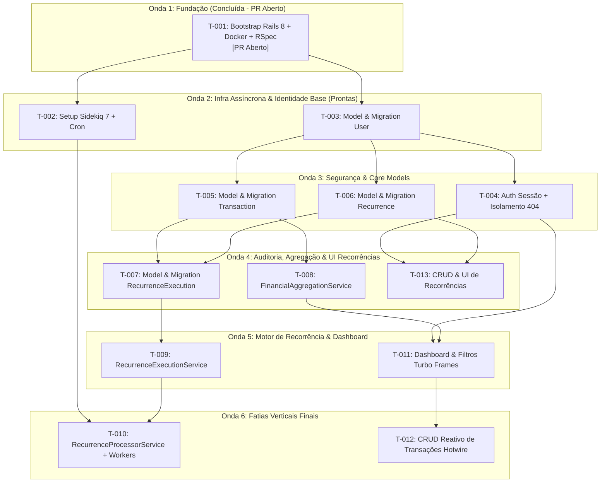

# Checklist de Execução das Tasks - MVP Sqr Finance

Este documento consolida o acompanhamento operacional e o status de implementação de todas as tarefas técnicas do MVP do **Sqr Finance**, organizadas em conformidade com o backlog em [TASKS-001: Backlog do MVP](../../backlog/TASKS-001-mvp-controle-financeiro.md) e as especificações técnicas em `docs/tech-specs/tasks/`.

---

## 1. Visão Geral do Progresso

- **Progresso Global:** `2 / 13 tasks (15.4%)`
- **Tasks Concluídas com PR Aberto:** 2 (`T-001`, `T-002`)
- **Tasks Desbloqueadas / Prontas para Execução:** 1 (`T-003`)
- **Tasks Bloqueadas por Dependências:** 10 (`T-004` até `T-013`)

### Legenda de Status
- 🟢 `[x]` **Concluída / PR Aberto:** Tarefa implementada, testes e linting validados, ADR formalizada e Pull Request aberto.
- 🟡 `[ ]` **Pronta para Iniciar:** Dependências satisfeitas, aguardando início do desenvolvimento ou merge prévio.
- 🔴 `[ ]` **Bloqueada:** Depende da conclusão/merge de tarefas anteriores.

---

## 2. Matriz Resumo de Acompanhamento

| ID | Status | Tech Spec | Título | Branch | Dependência | ADR Relacionada |
|:---:|:---:|---|---|---|---|---|
| `T-001` | 🟢 PR Aberto | [TS-T001](./TS-T001-bootstrap-rails-docker-rspec.md) | Bootstrap Rails 8, Docker Compose & Suíte RSpec | `chore/T-001-bootstrap-rails-docker-rspec` | Nenhuma | `ADR-005` (Formalizada) |
| `T-002` | 🟢 PR Aberto | [TS-T002](./TS-T002-setup-sidekiq-cron-redis.md) | Configuração do Sidekiq 7, Sidekiq Cron & Redis Queue | `chore/T-002-setup-sidekiq-cron-redis` | `T-001` | `ADR-006` (Formalizada) |
| `T-003` | 🟡 Pronta | [TS-T003](./TS-T003-user-model-and-migration.md) | Migration & Model User (Credenciais Únicas & Bcrypt) | `feat/T-003-user-model-and-migration` | `T-001` | `ADR-007` |
| `T-004` | 🔴 Bloqueada | [TS-T004](./TS-T004-session-auth-and-tenant-isolation.md) | Autenticação Dual, Current.user & Isolamento 404 | `feat/T-004-session-auth-and-tenant-isolation` | `T-003` | `ADR-008` |
| `T-005` | 🔴 Bloqueada | [TS-T005](./TS-T005-transaction-model-and-schema.md) | Migration & Model Transaction (Constraints & Índice) | `feat/T-005-transaction-model-and-schema` | `T-003` | `ADR-009` |
| `T-006` | 🔴 Bloqueada | [TS-T006](./TS-T006-recurrence-model-and-soft-delete.md) | Migration & Model Recurrence (Soft-Delete) | `feat/T-006-recurrence-model-and-soft-delete` | `T-003` | `ADR-002` |
| `T-007` | 🔴 Bloqueada | [TS-T007](./TS-T007-recurrence-execution-audit-model.md) | Migration & Model RecurrenceExecution (Idempotência) | `feat/T-007-recurrence-execution-audit-model` | `T-005, T-006` | `ADR-004` |
| `T-008` | 🔴 Bloqueada | [TS-T008](./TS-T008-financial-aggregation-service.md) | FinancialAggregationService (SQL Pushdown) | `feat/T-008-financial-aggregation-service` | `T-005` | `ADR-001` |
| `T-009` | 🔴 Bloqueada | [TS-T009](./TS-T009-recurrence-execution-service.md) | RecurrenceExecutionService (Materialização Atômica) | `feat/T-009-recurrence-execution-service` | `T-007` | `ADR-004` / `ADR-002` |
| `T-010` | 🔴 Bloqueada | [TS-T010](./TS-T010-recurrence-processor-and-workers.md) | RecurrenceProcessorService & Workers Sidekiq | `feat/T-010-recurrence-processor-and-workers` | `T-002, T-009` | `ADR-010` |
| `T-011` | 🔴 Bloqueada | [TS-T011](./TS-T011-dashboard-temporal-filters-hotwire.md) | Dashboard & Filtros com Turbo Frames (RF-007, RF-008) | `feat/T-011-dashboard-temporal-filters-hotwire` | `T-004, T-008` | `ADR-003` |
| `T-012` | 🔴 Bloqueada | [TS-T012](./TS-T012-reactive-transactions-crud-hotwire.md) | CRUD Reativo de Transações Hotwire (RF-002, RF-003) | `feat/T-012-reactive-transactions-crud-hotwire` | `T-011` | `ADR-003` |
| `T-013` | 🔴 Bloqueada | [TS-T013](./TS-T013-recurrences-crud-and-lifecycle-ui.md) | CRUD Reativo & Gestão de Recorrências (RF-004, RF-006) | `feat/T-013-recurrences-crud-and-lifecycle-ui` | `T-004, T-006` | `ADR-011` |

---

## 3. Fluxo de Dependências por Ondas (Kanban)

---

## 4. Checklist Detalhado das Tasks

### Onda 1: Fundação

#### [x] `T-001`: Bootstrap Rails 8, Docker Compose (PostgreSQL 16 + Redis 7) e Suíte RSpec
- **Status:** 🟢 **Concluída com PR Aberto**
- **Tech Spec:** [TS-T001-bootstrap-rails-docker-rspec.md](./TS-T001-bootstrap-rails-docker-rspec.md)
- **Branch:** `chore/T-001-bootstrap-rails-docker-rspec`
- **Dependência:** Nenhuma
- **ADR Formalizada:** [ADR-005: PostgreSQL 16 as Authoritative ACID Datastore](../../adrs/ADR-005-postgresql-16-authoritative-acid-datastore.md)
- **Definition of Done (DoD):**
  - [x] `docker compose up -d` sobe `postgres` e `redis` com status `healthy`.
  - [x] `bin/rails db:prepare` cria os bancos `sqr_finances_development` e `sqr_finances_test`.
  - [x] `bundle exec rspec` executa e passa sem erros (`spec/requests/healthcheck_spec.rb`).
  - [x] `bundle exec rubocop` executa com 0 ofensas.
  - [x] Formalizada a `ADR-005` em `docs/adrs/ADR-005-postgresql-16-authoritative-acid-datastore.md`.
  - [x] Pull Request aberto a partir da branch `chore/T-001-bootstrap-rails-docker-rspec`.

---

### Onda 2: Infraestrutura Assíncrona & Identidade Base

#### [x] `T-002`: Configuração do Sidekiq 7, Sidekiq Cron e Redis Queue
- **Status:** 🟢 **Concluída com PR Aberto**
- **Tech Spec:** [TS-T002-setup-sidekiq-cron-redis.md](./TS-T002-setup-sidekiq-cron-redis.md)
- **Branch:** `chore/T-002-setup-sidekiq-cron-redis`
- **Dependência:** `T-001`
- **ADR Formalizada:** [ADR-006: Asynchronous Job Processing with Redis 7, Sidekiq 7 and Sidekiq Cron](../../adrs/ADR-006-asynchronous-job-processing-with-redis-and-sidekiq.md)
- **Pull Request:** [PR #2](https://github.com/efsiqueira/sqr-finances/pull/2)
- **Definition of Done (DoD):**
  - [x] `bundle install` instala `sidekiq` e `sidekiq-cron`.
  - [x] `config/initializers/sidekiq.rb`, `config/sidekiq.yml` e `config/schedule.yml` criados.
  - [x] `Procfile.dev` atualizado com o processo `worker`.
  - [x] `bundle exec rspec spec/config/sidekiq_config_spec.rb` passa com sucesso.
  - [x] `bundle exec rubocop` com 0 ofensas.
  - [x] Formalizar a `ADR-006` em `docs/adrs/`.
  - [x] Pull Request aberto a partir da branch `chore/T-002-setup-sidekiq-cron-redis`.

#### [ ] `T-003`: Migration e Model de Usuário (User) com Credenciais Únicas e Bcrypt
- **Status:** 🟡 **Pronta para Iniciar** (Depende da base de código da `T-001`)
- **Tech Spec:** [TS-T003-user-model-and-migration.md](./TS-T003-user-model-and-migration.md)
- **Branch:** `feat/T-003-user-model-and-migration`
- **Dependência:** `T-001`
- **ADR a Formalizar:** `docs/adrs/ADR-007-stateful-session-authentication-with-bcrypt.md`
- **Definition of Done (DoD):**
  - [ ] Migration executada e refletida em `db/schema.rb` (tabela `users` com unicidade de e-mail e username).
  - [ ] Model `User` com `has_secure_password`, normalização de login e `.authenticate_by_login`.
  - [ ] `bundle exec rspec spec/models/user_spec.rb` passa com 100% dos cenários verdes.
  - [ ] `bundle exec rubocop` sem ofensas.
  - [ ] Formalizar a `ADR-007` em `docs/adrs/`.

---

### Onda 3: Segurança & Core Models

#### [ ] `T-004`: Autenticação de Sessão Dual (Email/Username), Current.user e Isolamento 404
- **Status:** 🔴 **Bloqueada**
- **Tech Spec:** [TS-T004-session-auth-and-tenant-isolation.md](./TS-T004-session-auth-and-tenant-isolation.md)
- **Branch:** `feat/T-004-session-auth-and-tenant-isolation`
- **Dependência:** `T-003`
- **ADR a Formalizar:** `docs/adrs/ADR-008-logical-multi-tenancy-and-404-indistinguishability.md`
- **Definition of Done (DoD):**
  - [ ] Fluxos de cadastro (`RegistrationsController`), login dual (`SessionsController`) e logout funcionais.
  - [ ] `Current.user` hidratado automaticamente em requisições autenticadas via `Authentication` concern.
  - [ ] `ActiveRecord::RecordNotFound` tratado com resposta indistinguível `404 Not Found`.
  - [ ] `bundle exec rspec spec/requests/authentication_spec.rb` passa com 0 falhas.
  - [ ] `bundle exec rubocop` sem ofensas.
  - [ ] Formalizar a `ADR-008` em `docs/adrs/`.

#### [ ] `T-005`: Migration e Model de Movimentações (Transaction) com Constraints CHECK e Índice Temporal
- **Status:** 🔴 **Bloqueada**
- **Tech Spec:** [TS-T005-transaction-model-and-schema.md](./TS-T005-transaction-model-and-schema.md)
- **Branch:** `feat/T-005-transaction-model-and-schema`
- **Dependência:** `T-003`
- **ADR a Formalizar:** `docs/adrs/ADR-009-materialized-transaction-facts-and-unsigned-monetary-model.md`
- **Definition of Done (DoD):**
  - [ ] Migration de `transactions` executada com índice composto `(user_id, occurred_at DESC)` e 3 `CHECK` constraints (`chk_positive_amount`, `chk_transaction_type`, `chk_payment_method`).
  - [ ] Model `Transaction` com validações espelhadas e precisão de duas casas decimais.
  - [ ] `bundle exec rspec spec/models/transaction_spec.rb` passa integralmente.
  - [ ] `bundle exec rubocop` sem ofensas.
  - [ ] Formalizar a `ADR-009` em `docs/adrs/`.

#### [ ] `T-006`: Migration e Model de Recorrências (Recurrence) com Soft-Delete e Constraints Simétricas
- **Status:** 🔴 **Bloqueada**
- **Tech Spec:** [TS-T006-recurrence-model-and-soft-delete.md](./TS-T006-recurrence-model-and-soft-delete.md)
- **Branch:** `feat/T-006-recurrence-model-and-soft-delete`
- **Dependência:** `T-003`
- **ADR a Formalizar:** `docs/adrs/ADR-002-decoupled-generated-transactions-and-history-preservation.md`
- **Definition of Done (DoD):**
  - [ ] Migration de `recurrences` executada com `deleted_at`, índice parcial `WHERE deleted_at IS NULL` e 5 constraints `CHECK`.
  - [ ] Model `Recurrence` implementado com escopos de ciclo de vida e método `soft_delete!`.
  - [ ] `bundle exec rspec spec/models/recurrence_spec.rb` passa com 0 falhas.
  - [ ] `bundle exec rubocop` sem ofensas.
  - [ ] Formalizar a `ADR-002` em `docs/adrs/`.

---

### Onda 4: Auditoria, Agregação & UI de Recorrências

#### [ ] `T-007`: Migration e Model de Execuções de Recorrência (RecurrenceExecution) com Chave de Idempotência
- **Status:** 🔴 **Bloqueada**
- **Tech Spec:** [TS-T007-recurrence-execution-audit-model.md](./TS-T007-recurrence-execution-audit-model.md)
- **Branch:** `feat/T-007-recurrence-execution-audit-model`
- **Dependência:** `T-005, T-006`
- **ADR a Formalizar:** `docs/adrs/ADR-004-database-enforced-idempotency-via-recurrence-execution.md`
- **Definition of Done (DoD):**
  - [ ] Migration de `recurrence_executions` executada com índice único `uq_recurrence_cycle (recurrence_id, scheduled_for)`.
  - [ ] Foreign keys configuradas: `ON DELETE RESTRICT` para recurrence e `ON DELETE SET NULL` para transaction.
  - [ ] `bundle exec rspec spec/models/recurrence_execution_spec.rb` passa com 0 falhas.
  - [ ] `bundle exec rubocop` sem ofensas.
  - [ ] Formalizar a `ADR-004` em `docs/adrs/`.

#### [ ] `T-008`: Implementação do FinancialAggregationService (Consolidação SQL Pushdown)
- **Status:** 🔴 **Bloqueada**
- **Tech Spec:** [TS-T008-financial-aggregation-service.md](./TS-T008-financial-aggregation-service.md)
- **Branch:** `feat/T-008-financial-aggregation-service`
- **Dependência:** `T-005`
- **ADR a Formalizar:** `docs/adrs/ADR-001-dynamic-balance-derivation-and-sql-pushdown.md`
- **Definition of Done (DoD):**
  - [ ] `app/services/financial_aggregation_service.rb` implementado retornando DTO imutável `Result` (`Data.define`).
  - [ ] Agregação de `total_income`, `total_expense`, `period_result` e `accumulated_balance` delegada ao PostgreSQL.
  - [ ] `bundle exec rspec spec/services/financial_aggregation_service_spec.rb` passa com 100% dos cenários.
  - [ ] `bundle exec rubocop` sem ofensas.
  - [ ] Formalizar a `ADR-001` em `docs/adrs/`.

#### [ ] `T-013`: CRUD Reativo e Gestão de Ciclo de Vida de Recorrências (RF-004, RF-006)
- **Status:** 🔴 **Bloqueada**
- **Tech Spec:** [TS-T013-recurrences-crud-and-lifecycle-ui.md](./TS-T013-recurrences-crud-and-lifecycle-ui.md)
- **Branch:** `feat/T-013-recurrences-crud-and-lifecycle-ui`
- **Dependência:** `T-004, T-006`
- **ADR a Formalizar:** `docs/adrs/ADR-011-thin-controllers-with-stateless-domain-service-objects.md`
- **Definition of Done (DoD):**
  - [ ] `RecurrencesController`, rotas e views Hotwire implementadas sobre `Current.user.recurrences.not_deleted`.
  - [ ] Pausa/reativação e soft delete preservando histórico sem afetar transações passadas.
  - [ ] `bundle exec rspec spec/requests/recurrences_spec.rb` passa com 0 falhas (incluindo isolamento 404).
  - [ ] `bundle exec rubocop` sem ofensas.
  - [ ] Formalizar a `ADR-011` em `docs/adrs/`.

---

### Onda 5: Motor de Recorrência & Dashboard

#### [ ] `T-009`: Implementação do RecurrenceExecutionService (Materialização Atômica e Idempotente)
- **Status:** 🔴 **Bloqueada**
- **Tech Spec:** [TS-T009-recurrence-execution-service.md](./TS-T009-recurrence-execution-service.md)
- **Branch:** `feat/T-009-recurrence-execution-service`
- **Dependência:** `T-007`
- **ADR a Atualizar:** `ADR-002` e `ADR-004`
- **Definition of Done (DoD):**
  - [ ] `app/services/recurrence_execution_service.rb` implementado com execução atômica via `ActiveRecord::Base.transaction`.
  - [ ] Tratamento transparente de duplicidade (`ActiveRecord::RecordNotUnique`) garantindo idempotência estrita.
  - [ ] `bundle exec rspec spec/services/recurrence_execution_service_spec.rb` passa com 0 falhas.
  - [ ] `bundle exec rubocop` sem ofensas.
  - [ ] Atualizar `ADR-002` e `ADR-004` em `docs/adrs/` com as referências ao serviço implementado.

#### [ ] `T-011`: Dashboard e Filtros Temporais com Turbo Frames (RF-007, RF-008)
- **Status:** 🔴 **Bloqueada**
- **Tech Spec:** [TS-T011-dashboard-temporal-filters-hotwire.md](./TS-T011-dashboard-temporal-filters-hotwire.md)
- **Branch:** `feat/T-011-dashboard-temporal-filters-hotwire`
- **Dependência:** `T-004, T-008`
- **ADR a Formalizar:** `docs/adrs/ADR-003-server-driven-reactive-ui-with-rails-8-and-hotwire.md`
- **Definition of Done (DoD):**
  - [ ] `DashboardController`, `PeriodFilterable` concern e views com Turbo Frames (`dashboard_metrics`, `transactions_list`).
  - [ ] Suporte a filtros `day`, `month`, `year` e `custom` (máximo de 365 dias).
  - [ ] `bundle exec rspec spec/requests/dashboard_spec.rb` passa com 0 falhas.
  - [ ] `bundle exec rubocop` sem ofensas.
  - [ ] Formalizar a `ADR-003` em `docs/adrs/`.

---

### Onda 6: Fatias Verticais Finais

#### [ ] `T-010`: Implementação do RecurrenceProcessorService e Sidekiq Workers de Recorrência
- **Status:** 🔴 **Bloqueada**
- **Tech Spec:** [TS-T010-recurrence-processor-and-workers.md](./TS-T010-recurrence-processor-and-workers.md)
- **Branch:** `feat/T-010-recurrence-processor-and-workers`
- **Dependência:** `T-002, T-009`
- **ADR a Formalizar:** `docs/adrs/ADR-010-fan-out-cron-scheduling-for-recurring-transactions.md`
- **Definition of Done (DoD):**
  - [ ] `RecurrenceProcessorService`, `RecurrenceSchedulerWorker` e `RecurrenceWorker` implementados.
  - [ ] Agendamento diário (`00:05 UTC`) configurado em `config/schedule.yml`.
  - [ ] Suporte a cálculo retroativo (*catch-up*) e desativação automática ao atingir `end_date`.
  - [ ] `bundle exec rspec spec/services/recurrence_processor_service_spec.rb spec/workers/` passa com 0 falhas.
  - [ ] `bundle exec rubocop` sem ofensas.
  - [ ] Formalizar a `ADR-010` em `docs/adrs/`.

#### [ ] `T-012`: CRUD Reativo de Movimentações com Turbo Streams e Stimulus (RF-002, RF-003)
- **Status:** 🔴 **Bloqueada**
- **Tech Spec:** [TS-T012-reactive-transactions-crud-hotwire.md](./TS-T012-reactive-transactions-crud-hotwire.md)
- **Branch:** `feat/T-012-reactive-transactions-crud-hotwire`
- **Dependência:** `T-011`
- **ADR a Atualizar:** `ADR-003`
- **Definition of Done (DoD):**
  - [ ] `TransactionsController` operando sobre `Current.user.transactions` com templates Turbo Stream reativos.
  - [ ] Controller Stimulus para visibilidade/obrigatoriedade condicional de `payment_method` (entradas vs. saídas).
  - [ ] Resposta indistinguível `404 Not Found` em acessos cruzados.
  - [ ] `bundle exec rspec spec/requests/transactions_spec.rb` passa com 0 falhas.
  - [ ] `bundle exec rubocop` sem ofensas.
  - [ ] Atualizar `ADR-003` com os contratos de Turbo Stream e Stimulus implementados.

---

## 5. Diretrizes Operacionais do Checklist

1. **Branch por Task:** Toda tarefa deve ser desenvolvida em branch específica nomeada segundo a coluna `Branch`.
2. **Docs-as-Code & ADRs:** Nenhuma task atinge DoD sem que a respectiva ADR seja promovida/atualizada em `docs/adrs/` e validada contra [potential-adrs-index.md](../../adrs/potential-adrs-index.md).
3. **Atualização Contínua:** Ao abrir um PR para uma nova task, marque a caixa correspondente neste checklist com `[x]` e anote o status `PR Aberto`. Ao concluir o merge, altere o status para `Concluída (Merged)`.
